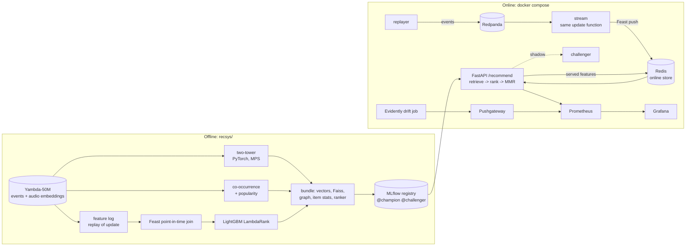
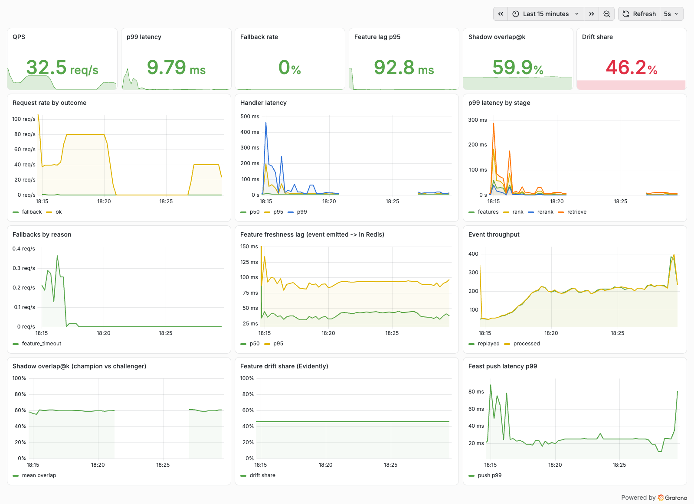

# realtime-recsys-platform

Music recommendations that react to what a listener is doing right now. Events from the
[Yambda-50M](https://huggingface.co/datasets/yandex/yambda) dataset are replayed into Redpanda,
a stream processor turns them into session features in Feast's Redis store, and a FastAPI
service retrieves, ranks and re-ranks ~650 candidates per request. Everything runs locally
with docker compose; models are versioned in MLflow and served by alias, with a challenger
scored in shadow mode.

What I measured (test day held out by time, all numbers from scripts in this repo):

- **Offline:** the full pipeline (four candidate sources -> LightGBM LambdaRank -> MMR) gets
  **Recall@10 0.072 / NDCG@10 0.061**, against 0.010 / 0.007 for recent popularity and 0.043 / 0.038
  for the best single source.
- **Latency:** one request costs **4.8 ms p50, 8.9 ms p99** inside the API (feature read 0.6 ms,
  retrieval 2.5, ranking 1.4, MMR 0.2). Under load on the laptop the p99 stays under 50 ms only
  up to ~25 QPS; above that it is dominated by queueing in one Python process, not by any stage
  (details below). **The 50 ms p99 target is not met at higher rates on this machine.**
- **Freshness:** a listen reaches the online store **41 ms p50 / 93 ms p95** after it is emitted.
- **Skew:** a test drives the real stream code into Redis and compares every feature, for every
  user, with Feast's point-in-time join at the same timestamp. They match exactly.

## How the pieces fit



The design decisions behind this, and what they cost, are in [docs/design.md](docs/design.md).



The dashboard during a replay at 60x speed with 40 QPS of traffic: per-stage p99, fallback rate
(the blip at the start is feature reads exceeding their 25 ms budget while traffic peaked),
event-to-Redis lag,
champion/challenger overlap (~60%) and the Evidently drift share after injecting skip-heavy
sessions.

## Data and evaluation setup

Yambda-50M: 10,000 users, 934,057 tracks, 47.8M events over 300 days (listens with played
ratio, likes, dislikes), an `is_organic` flag that separates listens the user chose from ones
Yandex's recommender served, and 128-d audio embeddings for 91% of the tracks. I use the dataset's
own global temporal split: the last day is test, the day before is validation, with 30-minute gaps.

A request is placed one second before a random listen (3 per active user per day); its positives
are tracks played at least 50% in the following hour, minus the user's last 50 listens, because
the product never recommends a recently played track and 69% of test-day positives are repeats.
11,196 test requests have at least one positive left. Every request goes through the same
`recommend()` function the API calls, with features from Feast's point-in-time join.

## Offline results

| method | Recall@10 | NDCG@10 | distinct items | diversity | novelty | pop. percentile |
|---|---|---|---|---|---|---|
| recent popularity (baseline) | 0.010 | 0.007 | 39 | 0.284 | 10.4 | 99.99 |
| co-occurrence | 0.043 | 0.038 | 40,880 | 0.652 | 17.5 | 78.4 |
| two-tower | 0.035 | 0.028 | 23,383 | 0.338 | 15.2 | 90.5 |
| SASRec (notebook, 6 epochs on MPS) | 0.027 | 0.020 | 10,894 | 0.502 | 16.6 | 81.4 |
| ranker v1 (no session features) | 0.069 | 0.059 | 28,316 | 0.350 | 14.7 | 94.5 |
| ranker v2 | 0.072 | 0.061 | 26,702 | 0.343 | 14.6 | 94.7 |
| **ranker v2 + MMR** | **0.072** | **0.061** | 27,202 | 0.354 | 14.6 | 94.6 |
| what users actually played | | | | | 16.0 | 88.1 |

Recall@K is hits / min(|positives|, K). Diversity is 1 - mean pairwise cosine within the top-10;
novelty is mean self-information of recommended tracks; popularity percentile is among tracks
played in the last 30 days.

- Session features (v2 vs v1) add **+0.0025 Recall@10, 95% CI [+0.0007, +0.0043]** (paired bootstrap
  over requests). Real, but small.
- MMR at λ=0.8 changes Recall@10 by +0.0001 (CI [-0.0006, +0.0007]) and raises diversity from 0.343
  to 0.354. Cheap, and not worth much at this setting.
- The ranker recommends more popular tracks than people play (94.7th vs 88.1th percentile), see
  [the histogram](results/figures/popularity_bias.png).

Candidate generation, recall over the union of sources (~650 items):

| source | Recall@100 | Recall@200 |
|---|---|---|
| recent popularity | 0.045 | 0.068 |
| co-occurrence | 0.094 | 0.121 |
| two-tower (Faiss IVF-SQ8) | 0.150 | 0.221 |
| SASRec | 0.133 | 0.204 |
| fresh pool (30 items, cold start) | 0.001 | 0.001 |
| **union of the four served sources** | | **0.332** |

Recall@10 by slice:

| slice | requests | popularity | co-occurrence | two-tower | fresh pool | ranker v2 + MMR | candidate union |
|---|---|---|---|---|---|---|---|
| all | 11,196 | 0.010 | 0.043 | 0.035 | 0.001 | 0.072 | 0.332 |
| organic positives | 5,528 | 0.015 | 0.086 | 0.048 | 0.000 | 0.125 | 0.396 |
| recommendation-driven positives | 6,468 | 0.006 | 0.006 | 0.022 | 0.001 | 0.026 | 0.276 |
| cold items (<5 plays before cutoff) | 1,129 | 0.000 | 0.004 | 0.000 | 0.020 | 0.008 | 0.057 |
| light users (bottom 20% history) | 2,069 | 0.011 | 0.050 | 0.038 | 0.002 | 0.080 | 0.391 |

Yambda-50M has no users who are new in the test period, so "light users" stands in for them.
Full numbers: [results/offline_metrics.json](results/offline_metrics.json); figures in
[results/figures](results/figures).

## Latency

One request at a time from the host (`scripts/loadtest.py --sequential`, 1,000 requests):

| | features | retrieve | rank | rerank | handler total | client |
|---|---|---|---|---|---|---|
| p50 ms | 0.64 | 2.54 | 1.43 | 0.17 | 4.79 | 6.2 |
| p99 ms | 2.23 | 3.94 | 2.10 | 0.35 | 8.90 | 12.3 |

Under load (k6, constant arrival rate, 60 s per level, one API worker, 25% of requests also
scored by the challenger, replay streaming at the same time):

| QPS (target / achieved) | client p50 / p95 / p99 ms | server p50 / p95 / p99 ms | p99 by stage: features / retrieve / rank / rerank ms |
|---|---|---|---|
| 25 / 25.1 | 9.5 / 13.7 / **30.3** | 7.7 / 11.1 / 26.4 | 4.2 / 9.2 / 9.8 / 0.6 |
| 50 / 49.9 | 8.4 / 14.9 / **113.3** | 7.0 / 11.7 / 77.5 | 10.6 / 31.0 / 15.5 / 2.1 |
| 75 / 75.1 | 6.8 / 35.1 / 152.0 | 5.8 / 28.6 / 106.5 | 14.7 / 52.5 / 33.7 / 9.2 |
| 100 / 100.2 | 5.5 / 41.6 / 618.8 | 4.9 / 28.9 / 234.6 | 28.5 / 122.8 / 83.6 / 23.5 |
| 150 / 150.2 | 5.5 / 11.1 / 130.7 | 4.8 / 9.0 / 92.8 | 9.4 / 42.9 / 26.9 / 8.0 |

Where the time goes: the median barely moves with load, and at the tail every stage inflates
together. That is queueing for the CPU, not a slow component: one Python process holds the GIL,
the Colima VM has 4 vCPUs shared with Redpanda, the stream processor, k6 itself and the Mac's
desktop apps. The p99 is also noisy run to run (the 100 QPS row is worse than 150) for the same
reason: across repeated runs during development the 50 QPS p99 ranged from 13 ms to 113 ms,
while the medians stayed within a millisecond of each other.
Shadow scoring at 100% of requests roughly halves capacity (two full pipelines per request),
which is why the default shadows a 25% sample.

What I'd do next, in order: compile the LightGBM model (lleaves/treelite) to cut the ranking
stage, run several API processes on a machine with the memory for them (see below), and move
shadow scoring out of the serving process into a consumer of the request log.

## Running it

Needs Docker (Colima with 4 CPUs / 8 GB is enough), [uv](https://docs.astral.sh/uv/), ~2 GB of
disk for data and models and ~8 GB for images.

```bash
make data       # download Yambda-50M (streams the 13.8 GB embeddings file, keeps 220 MB) and split
make offline    # features + Feast joins, two-tower (MPS if available), rankers, evaluation, MLflow
make up         # the stack; API on :8000, Grafana on :3000, MLflow on :5002, Prometheus on :9090
make loadtest   # k6 at several rates -> results/loadtest.md
make drift-demo # inject skip-heavy sessions, watch the FeatureDrift alert fire
make promote    # challenger -> champion (and `make rollback`)
```

`curl "localhost:8000/recommend?user_id=100&k=10"` returns the items, the model version and
per-stage timings. `make test` runs the tests on a synthetic fixture with the same timestamps as
the real split; CI runs them plus the whole pipeline and a short load test on that fixture.

## What didn't work, or surprised me

**Recommendation-driven listens are a different problem.** Half the test-day positives come from
Yandex's own recommender (`is_organic = 0`). Every model does far better on organic listens:
co-occurrence gets 0.086 Recall@10 on organic positives and 0.006 on recommendation-driven ones,
the ranker 0.125 vs 0.026. My guess: organic sessions follow the user's own habits (same
artists, albums in order), which session features capture, while the platform's recommender
picks tracks to explore. The catch is the feedback loop. Training data already contains the old
recommender's choices, so a model trained and evaluated on all events is partly rewarded for
imitating it. Slicing makes that visible; I did not correct for it (inverse propensity weighting
would need the logging policy's probabilities, which the dataset does not have).

**The ranker first "converged" at iteration 1.** I had written each query's positives before its
sampled negatives. Early in boosting most scores tie, LightGBM breaks ties by row order, so
validation NDCG peaked at the first tree and early stopping kept a one-tree model. Training NDCG
*decreasing* with more trees gave it away. Shuffling rows within each query fixed it; together
with the fresh pool added in the same run (which barely moves top-10 numbers) the ranker went from
0.053 to 0.070 Recall@10.

**Feast's Redis store silently drops same-timestamp writes.** Yambda bins timestamps to 5 seconds,
so a user's second event in a bin never reached Redis, while the offline join used it. The skew
test caught it (and fails again if the fix is removed). Each event in a bin now gets a
microsecond offset in the shared feature function.

**The two-tower does not retrieve cold items on its own.** Audio-only vectors for tracks with no
ID embedding almost never reach the global top-200 next to warm tracks (0.000 Recall@10 on the cold
slice). Scoring a separate pool of 44k new or unplayed tracks with the same user vector lifts the
candidate union's recall on cold positives from 0.025 to 0.057, which is still small.

**SASRec collapsed twice before it worked.** First to the same few dozen hits for everyone: with
`nn.Embedding`'s default N(0, 1) init and tied output weights the initial logits were around ±40 and
the model never used the sequence. Then PyTorch's transformer inference fast path returned NaN for
left-padded sequences when given a key-padding mask in eval mode. With a small init,
frequency-sampled negatives with logQ correction and no padding mask, it reaches Recall@200 0.204,
close to the two-tower's 0.221, but it is weaker at the top of the list and I did not feed it to
the ranker.

**More API workers made latency worse.** Three uvicorn workers in the 2.5 GB container pushed it to
its memory limit; the kernel kept evicting the memory-mapped bundle pages (millions of major page
faults) and capacity dropped instead of tripling. Memory-mapping the bundle arrays did cut a single
worker from ~960 MB to ~450 MB, so it is the right direction on a machine with headroom.

## Limitations

- One test day, sampled requests and a one-hour label window. The absolute numbers are low
  because the task (next-hour listens, repeats excluded, ~934k tracks) is hard; the comparisons
  between methods are what matter.
- The p99 < 50 ms target holds only at low request rates on this laptop (above).
- The stream processor keeps state in memory and rebuilds it on restart (~40 s); there is no
  checkpointing and a single partition.
- The offline feature log is built by a Python loop over 16 days of events (~30 s); fine here,
  not at 5B.
- Shadow mode measures how different the challenger is (overlap ~60%), not whether it is better.
  The registry promotion here is driven by the offline numbers.
- The item catalogue is taken as known in advance (tracks that first appear on the test day are in
  the index with their audio vectors), as it would be for a streaming service ingesting releases.

## Scaling to Yambda-5B

The 5B version has 1M users, 9.4M tracks and 4.8B events: 100x the users and 10x the catalogue.

- **Features:** the same `update()` function as a keyed stateful operator in Flink (or a Spark
  job over user-partitioned data for the offline log), so the no-skew property survives; state is
  per user and partitions cleanly.
- **Retrieval:** 9.4M x 64 float vectors are 2.4 GB; IVF-PQ in Faiss (or ScaNN) brings that under
  300 MB per replica. The fresh pool would need its own small index instead of brute force.
- **Co-occurrence and popularity:** a daily Spark job; at top-30 neighbours the CSR graph is up to
  ~280M edges (~2 GB), still fine to memory-map per replica.
- **Online store:** 1M users x ~1 KB of session state is ~1 GB in Redis; a small cluster with
  per-user keys, no change to the Feast definitions.
- **Training:** two-tower and SASRec on a GPU; the ranker on sampled requests (the 50M run used
  7.8k queries and 1.6M rows, which LightGBM handles on a laptop).
- **Serving:** stateless API replicas behind a load balancer, each memory-mapping the bundle; the
  per-request cost does not depend on the number of users.

## Layout

```
recsys/          data, features, store (Feast), candidates, two_tower, ranker, rerank,
                 serving, evaluate, train, registry, drift
services/        api/, stream/, replayer/  (one Dockerfile each)
infra/           docker-compose.yml, feast/, prometheus/, grafana/
scripts/         loadtest (k6), inject_drift, promote, screenshot_dashboard
notebooks/       sasrec.ipynb (GPU, optional)
tests/           skew, leakage, API contract/fallback/shadow, serving parity
results/         metrics, tables and figures written by the scripts
```

Data: Yandex Yambda, Apache 2.0. Code: MIT.
